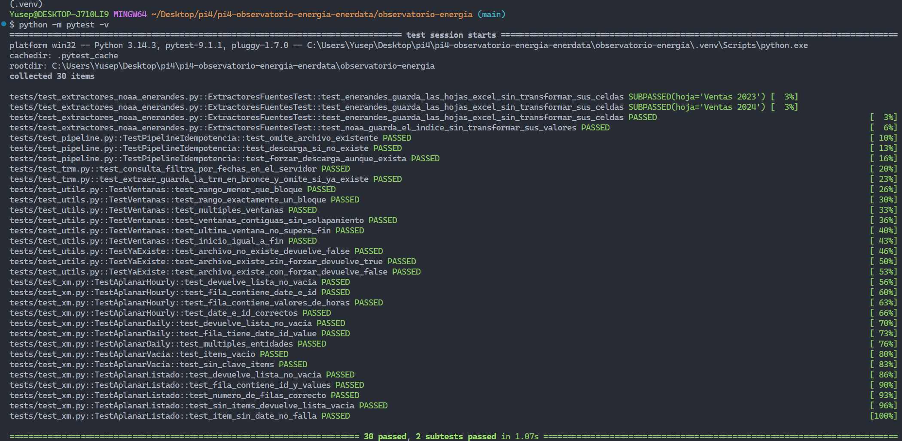
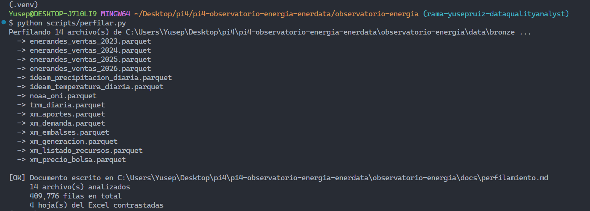
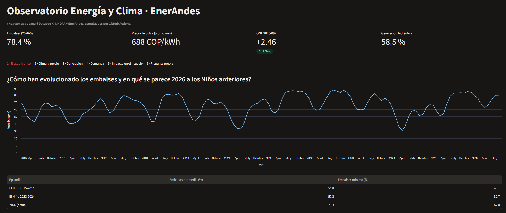
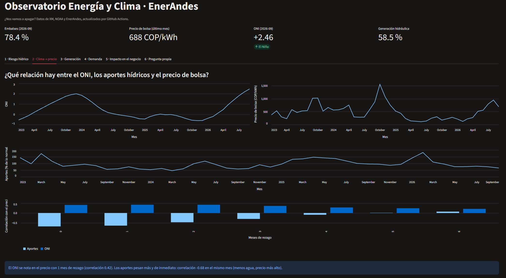
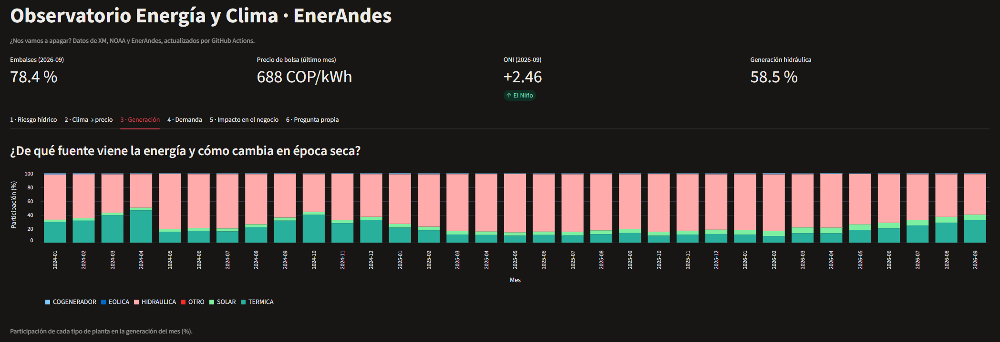
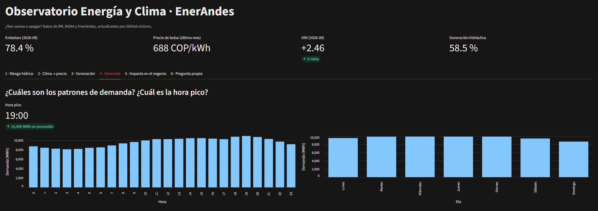
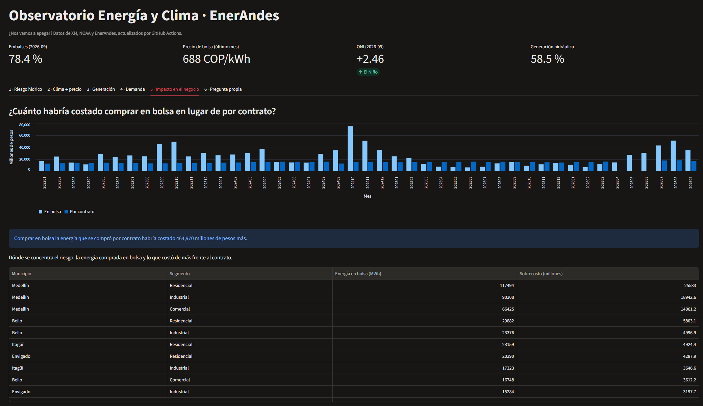
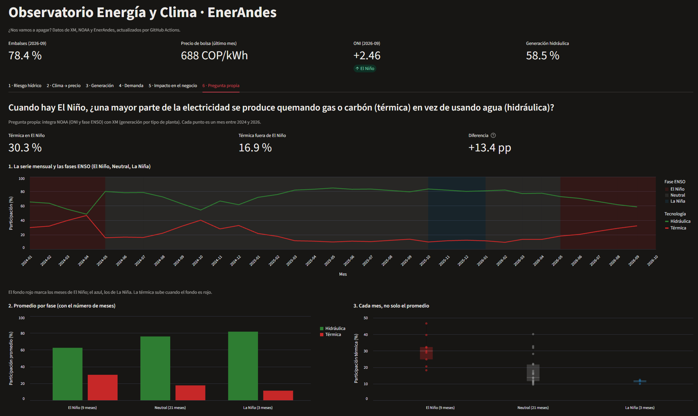
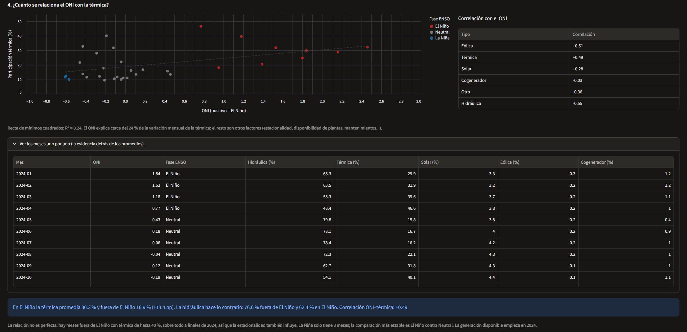

# Observatorio Energía y Clima – Equipo EnerData

> Proyecto Integrado IV – Integración de Información · IU Digital de Antioquia · 2026-2
> **EA1 – Extracción de datos de fuentes reales con Python**

## 👥 Integrantes

| Nombre | Usuario GitHub | Rol |
|---|---|---|
| Jorge Rodriguez | @jorgerodriguezdev | Líder técnico / Data Engineer |
| Yusep Ruiz | @yusepruiz | Data Engineer |
| Lina Johana Seguro | @LinaSeguro | BI Analyst |
| Raúl Niño | @Buclex | Analytics Engineer |

## 🎯 Objetivo

Integrar datos del mercado eléctrico (XM), del clima (IDEAM y NOAA) y de ventas internas (EnerAndes) para analizar el riesgo energético de Colombia ante El Niño 2026.

En esta evidencia (EA1) se construye la **capa bronce**: un programa en Python que extrae cinco fuentes reales y las guarda **tal como llegan**, sin limpiarlas, en formato Parquet y con el registro de su origen (linaje).

## 📦 Fuentes de datos (capa bronce)

| Fuente | Tipo | Archivo en `data/bronze/` |
|---|---|---|
| XM – API Sinergox | API REST (POST, JSON) | `xm_precio_bolsa`, `xm_demanda`, `xm_embalses`, `xm_generacion`, `xm_aportes`, `xm_listado_recursos` |
| IDEAM – datos.gov.co | API Socrata (SoQL) | `ideam_precipitacion_diaria`, `ideam_temperatura_diaria` |
| NOAA – índice ONI | Archivo de texto | `noaa_oni` |
| EnerAndes | Excel interno | `enerandes_ventas_2023` … `enerandes_ventas_2026` |
| **TRM – Banco de la República (fuente propia)** | API Socrata (SoQL) | `trm_diaria` |

### Fuente propia: TRM (Tasa de Cambio Representativa del Mercado)

- **Qué es:** el valor oficial diario del dólar en pesos colombianos (USD/COP).
- **De dónde viene:** portal de datos abiertos datos.gov.co, dataset "TRM – Banco de la República, tasa de cambio diaria" (`32sa-8pi3`), consultado con SoQL y filtrado por fechas en el servidor.
- **Para qué la usamos:** en un año de El Niño baja la generación hidráulica y el sistema recurre más a plantas térmicas, cuyos combustibles se cotizan en dólares. Cruzaremos la TRM con el precio de bolsa de XM para analizar cuánto del costo de la energía se explica por el tipo de cambio.

### Rangos de fechas

| Fuente | Rango |
|---|---|
| XM | 2024-01-01 a 2026-09-30 |
| IDEAM (lluvia y temperatura) | 2025-01-01 a 2026-09-30 (el IDEAM publica con retraso: el último dato es del 2026-07-24) |
| TRM | 2024-01-01 a 2026-09-30 |

## ⚙️ Cómo ejecutar

Requisitos: Python 3.11 o superior, Git y VS Code.

```powershell
git clone https://github.com/jorearmando15/pi4-observatorio-energia-enerdata.git
cd pi4-observatorio-energia-enerdata
python -m venv .venv
.\.venv\Scripts\Activate.ps1
python -m pip install -r requirements.txt
# copiar ventas_enerandes_2023_2026.xlsx en data/insumos/
python -m src.pipeline          # descarga las 5 fuentes a data/bronze/ (unos 40 minutos, casi todo es el IDEAM)
python -m src.transformar       # limpia y valida plata, luego construye y prueba oro con dbt
python -m src.consultar         # consultas SQL de BI con DuckDB
```

> Si el repositorio tiene el proyecto dentro de la carpeta `observatorio-energia`, entra a ella con `cd observatorio-energia` antes de crear el entorno virtual.

`python -m src.transformar` requiere los datos de bronce existentes y `dbt-duckdb`
instalado en el entorno virtual. No descarga datos: primero ejecuta todas las
limpiezas y validaciones de plata y genera el reporte de calidad; solo si esa
etapa termina correctamente ejecuta `dbt build` para crear y probar oro. Para
ejecutar únicamente la limpieza de plata, usa `python -m src.silver.pipeline`.

Para volver a descargar todo: `python -m src.pipeline --forzar`. El rango de fechas se cambia en `src/config.py`.

### XM (API REST del mercado eléctrico)

El pipeline consulta la API de XM con peticiones `POST` y cuerpo JSON, en **ventanas de 30 días** (el máximo que acepta la API), del 2024-01-01 al 2026-09-30. Extrae seis archivos:

- **Por hora:** precio de bolsa (`PrecBolsNaci`), demanda real (`DemaReal`) y generación por planta (`Gene`, entidad `Recurso`).
- **Por día:** porcentaje útil de embalses (`PorcVoluUtilDiar`) y aportes hídricos (`AporEner`).
- **Catálogo de plantas** (`ListadoRecursos`): se consulta en el endpoint `lists`, no por ventanas de fechas, y responde con una estructura distinta (`Items > ListEntities > Values`), que se aplana con `aplanar_listado()`.

Cada métrica nueva se agrega como una línea en `XM_METRICAS` de `src/config.py`, y los catálogos en `XM_LISTADOS`. Para ejecutar solo XM (unos 10 minutos):

```powershell
python -m src.extract.xm
```

### IDEAM (datos abiertos con SoQL)

Extrae, para el departamento de Antioquia, la **precipitación** y la **temperatura del aire** (datasets `s54a-sgyg` y `sbwg-7ju4` de datos.gov.co) desde el 2025-01-01, semana por semana. Estos datasets tienen millones de observaciones, así que el **filtrado y la agregación se hacen en el servidor** con SoQL y no en Python:

- `$where` filtra el departamento y las fechas de cada semana.
- `$select` calcula una fila por estación y día: la suma de lluvia (`sum`) o la temperatura media, mínima y máxima (`avg`, `min`, `max`).
- `$group`, `$limit` y `$offset` agrupan por estación y día y paginan la respuesta.

El IDEAM publica con retraso: el último dato disponible es del **2026-07-24**, y las semanas posteriores devuelven 0 filas. No es un error del pipeline. Para ejecutar solo el IDEAM (unos 17 minutos):

```powershell
python -m src.extract.ideam
```

### NOAA y ventas de EnerAndes

El pipeline extrae el índice ONI de NOAA desde su archivo de texto y las hojas del Excel `data/insumos/ventas_enerandes_2023_2026.xlsx`. Cada hoja de ventas se guarda por separado. En la capa bronce se conservan sus filas y valores de origen; solo se asignan nombres de columna para las hojas de Excel y se agregan los campos de linaje `_fuente`, `_origen` y `_extraido_en`. La limpieza y normalización corresponde a capas posteriores.

El Excel de EnerAndes es un insumo local y no se descarga automáticamente. Debe obtenerse por un canal autorizado. Para ejecutar solo las extracciones de estas dos fuentes:

```powershell
python -m src.extract.noaa
python -m src.extract.enerandes
```

### TRM (fuente propia)

Descarga la tasa de cambio USD/COP del dataset `32sa-8pi3` de datos.gov.co, filtrada por fechas en el servidor, y la guarda como `trm_diaria`. Para ejecutar solo esta fuente:

```powershell
python -m src.extract.trm
```

## 🥇 Capa oro: modelo estrella y consultas de negocio

La capa oro se construye con dbt en `data/observatorio.duckdb` y contiene
**3 tablas de hechos y 5 dimensiones**. La documentación completa está en:

- [`docs/modelo_dimensional.md`](docs/modelo_dimensional.md): diagrama Mermaid
  del esquema estrella y explicación del grano de cada hecho.
- [`docs/diccionario_datos.md`](docs/diccionario_datos.md): diccionario con
  columna, tipo de dato, descripción y origen de las 8 tablas de oro.

Para reconstruir solo la capa oro, con plata ya procesada y las fuentes de
bronce requeridas disponibles:

```powershell
.\.venv\Scripts\dbt.exe build --project-dir dbt --profiles-dir dbt
```

Para construir primero plata y después oro con un solo comando, usa
`python -m src.transformar` desde la raíz de `observatorio-energia`.

### Consultas de negocio

Las consultas SQL están en `consultas/oro/` y se ejecutan contra la base oro en
modo solo lectura:

```powershell
.\.venv\Scripts\python.exe -c "import duckdb, pathlib; con=duckdb.connect('data/observatorio.duckdb', read_only=True); [print('==', p.name, '==\n', con.sql(p.read_text(encoding='utf-8')).df().to_string(index=False)) for p in sorted(pathlib.Path('consultas/oro').glob('*.sql'))]"
```

#### 1. ¿Cómo cambian el precio y la demanda según la fase ENSO?

Consulta: `consultas/oro/01_impacto_enso_precio_demanda.sql`

| fase_enso | horas | precio_promedio_cop_kwh | demanda_promedio_kwh | precio_maximo_cop_kwh |
|:---|---:|---:|---:|---:|
| El Niño | 5,856 | 661 | 9,753,759 | 1,279 |
| Neutral | 15,312 | 414 | 9,475,758 | 2,676 |
| La Niña | 2,208 | 223 | 9,650,512 | 1,079 |

**Lectura:** en promedio, la energía es más cara en El Niño (661 COP/kWh) que
en Neutral (414) y que en La Niña (223). La demanda promedio es similar en las
tres fases, así que la diferencia de precio no se explica solo por demanda: es
consistente con una menor oferta hidráulica en la fase cálida. La consulta
excluye las 720 horas de septiembre de 2026 que aún no tienen ONI.

#### 2. ¿Cómo evolucionó la matriz de generación por tipo de planta?

Consulta: `consultas/oro/02_matriz_generacion_por_tipo.sql`

| anio | tipo | generacion_gwh | participacion_pct |
|---:|:---|---:|---:|
| 2024 | Hidráulica | 54,494.3 | 66.1 |
| 2024 | Térmica | 24,441.8 | 29.7 |
| 2024 | Solar | 3,297.2 | 4.0 |
| 2024 | Eólica | 148.8 | 0.2 |
| 2025 | Hidráulica | 68,099.4 | 81.5 |
| 2025 | Térmica | 10,813.8 | 12.9 |
| 2025 | Solar | 4,473.8 | 5.4 |
| 2025 | Eólica | 154.9 | 0.2 |
| 2026 | Hidráulica | 47,528.3 | 72.2 |
| 2026 | Térmica | 12,935.5 | 19.6 |
| 2026 | Solar | 5,229.4 | 7.9 |
| 2026 | Eólica | 155.2 | 0.2 |

**Lectura:** 2025 fue el año más húmedo de la muestra (81,5% hidráulica y
12,9% térmica). En 2026 (enero a septiembre) la hidráulica baja a 72,2% y la
térmica sube a 19,6%, señal de mayor dependencia de plantas térmicas. 2024 ya
había sido un año seco (66,1% hidráulica y 29,7% térmica). La comparación de
2026 es indicativa porque el año está incompleto. La tabla incluye las cuatro
tecnologías principales; Cogenerador y No informado quedan fuera.

#### 3. ¿En qué horas se concentra la demanda y cuándo es más cara la energía?

Consulta: `consultas/oro/03_perfil_horario_demanda_precio.sql`

| hora | precio_promedio_cop_kwh | demanda_promedio_kwh |
|---:|---:|---:|
| 1 | 420 | 8,712,276 |
| 2 | 410 | 8,416,696 |
| 3 | 398 | 8,200,509 |
| 4 | 392 | 8,082,390 |
| 5 | 399 | 8,169,164 |
| 6 | 418 | 8,396,449 |
| 7 | 415 | 8,495,009 |
| 8 | 407 | 8,905,922 |
| 9 | 404 | 9,341,291 |
| 10 | 405 | 9,634,153 |
| 11 | 420 | 9,965,998 |
| 12 | 438 | 10,239,409 |
| 13 | 438 | 10,236,644 |
| 14 | 450 | 10,313,571 |
| 15 | 471 | 10,439,279 |
| 16 | 490 | 10,446,260 |
| 17 | 508 | 10,343,585 |
| 18 | 522 | 10,229,709 |
| 19 | 611 | 10,752,275 |
| 20 | 659 | 10,909,207 |
| 21 | 585 | 10,690,808 |
| 22 | 533 | 10,271,439 |
| 23 | 492 | 9,713,525 |
| 24 | 458 | 9,162,098 |

**Lectura:** la demanda máxima se concentra entre las horas 19 y 21 (10,75 a
10,91 GWh/h) y el precio promedio máximo ocurre en la hora 20 (659 COP/kWh).
Las horas 3 a 5 son el valle, con precios de 392 a 399 COP/kWh y demanda de
8,08 a 8,20 GWh/h. La hora 1 equivale a 00:00-01:00 y la 24 a 23:00-24:00.

#### 4. ¿Qué municipios concentran las ventas de energía de EnerAndes?

Consulta: `consultas/oro/04_ventas_por_municipio.sql`

| municipio | energia_gwh | valor_millones_cop | clientes_promedio_mes |
|:---|---:|---:|---:|
| Medellín | 1,246.7 | 1,250,093 | 79,774 |
| Bello | 318.4 | 319,371 | 20,116 |
| Itagüí | 239.9 | 240,529 | 15,524 |
| Envigado | 211.1 | 209,413 | 13,697 |
| Rionegro | 150.1 | 150,527 | 9,752 |
| Sabaneta | 111.5 | 111,511 | 7,106 |
| Apartadó | 100.1 | 98,993 | 6,422 |
| Turbo | 73.8 | 73,772 | 4,779 |
| La Estrella | 62.2 | 61,756 | 3,984 |
| Caldas | 62.1 | 61,707 | 4,009 |

**Lectura:** Medellín concentra 1.246,7 GWh, cerca del 44% de la energía
vendida por EnerAndes, y un promedio de 79.774 clientes por mes. Los 10
municipios de la tabla reúnen alrededor del 91% del total vendido, así que el
mercado está altamente concentrado en el Valle de Aburrá y el Oriente
antioqueño.

## 🧪 Pruebas automáticas

```powershell
python -m pytest
```

Verifican, entre otras cosas, que `ventanas()` parta bien un rango de fechas, que `aplanar()` y `aplanar_listado()` conviertan bien un JSON de ejemplo, que la consulta SoQL del IDEAM agregue en el servidor y que el pipeline omita los archivos que ya existen. Usan una red simulada, así que no dependen de internet.

## 🗂️ Muestras de los datos

Después de ejecutar el pipeline, genera un CSV con hasta 200 filas por cada Parquet de bronce:

```powershell
python -m src.muestras
```

Los archivos se guardan en `data/sample/`, conservan los encabezados y las columnas de linaje y no reemplazan los Parquet originales. Los datos completos de `data/bronze/` **no** se suben a GitHub.

## 🔎 Perfilamiento de los datos

```powershell
python -m src.perfilar
```

Genera `docs/perfilamiento.md` con una tabla por cada archivo de bronce (filas, columnas, tipos de dato, % de nulos, filas duplicadas y rango de fechas) y los hallazgos de calidad con su evidencia numérica.

## 📸 Capturas de la consola

**Pipeline completo** (`python -m src.pipeline`):


**Pruebas** (`python -m pytest`):



**Perfilamiento** (`python -m src.perfilar`):



## 🎥 Videos de sustentación

| Integrante | Rol | Video |
|---|---|---|
| Jorge Rodriguez | Líder técnico / Data Engineer | [Ver video](https://drive.google.com/file/d/1bNzNJwje_EeHqYgiBoDBWKPW9aPt2dA1/view?usp=sharing) |
| Yusep Ruiz | Data Quality Analyst | [Ver video](https://drive.google.com/file/d/1quJ8_TNNZsXduqJig9HSMViziSR730vp/view?usp=sharing) |
| Lina Johana Seguro | Analytics Engineer | [Ver video](https://drive.google.com/file/d/1zafbLwwhQ_-Nvk-pmjohu1Ui20SjReix/view?usp=sharing) |
| Raúl Niño | BI Analyst / Storyteller | [Ver video](https://drive.google.com/file/d/1NDFI49wHwS2ki0AsmxmCEgZ0HVhW3n1h/view?usp=sharing) |

## 🏗️ Arquitectura

```
Fuentes -> BRONCE (dato tal cual + linaje) -> PLATA (limpio) -> ORO (modelo estrella) -> Dashboard
```

## 🤖 Uso de IA

Se usó Claude (Anthropic) como asistente de programación para escribir y explicar parte del código de los extractores, las pruebas con pytest y los scripts de muestras y perfilamiento. El equipo ejecutó, revisó y probó el código contra las fuentes reales.

Para la entrega **EA3** se usó además **OpenCode** (asistente de IA en el editor) como apoyo para implementar el dashboard en Streamlit, los gráficos de Altair, las pruebas de `tests/test_dashboard.py` y la organización de esta documentación. El equipo ejecutó, revisó y contrastó todo el código y las cifras contra las fuentes reales; la IA no generó datos ni reemplazó las decisiones de análisis.

---

# 📘 EA3 – Observatorio, dashboard y cierre del proyecto

## 🎯 Objetivo de la entrega final

Consolidar el observatorio en un **dashboard reproducible** que responda las seis
preguntas de negocio con las tablas de la capa oro, documentar la calidad de los
datos de punta a punta y dejar trazabilidad de las decisiones tomadas desde EA1
hasta EA3.

## 🏗️ Arquitectura ampliada (EA3)

```text
Fuentes: XM · IDEAM · NOAA · EnerAndes · TRM
                     |
                     v
         BRONCE · Parquet crudo + linaje
                     |
                     v
         PLATA · limpio + Pandera + cuarentena
                     |
                     v
         ORO · dbt + DuckDB (modelo estrella)
                     |
                     v
           data/gold/*.parquet
                     |
                     v
         Dashboard · Streamlit + Altair
```

| Capa | Tecnología | Qué contiene | Dónde vive |
|---|---|---|---|
| Bronce | Python + pandas + requests | 14 Parquet con el dato original y linaje | `data/bronze/` (no se sube a Git) |
| Plata | pandas + Pandera | 14 conjuntos limpios y tablas de cuarentena | `data/silver/` (no se sube a Git) |
| Oro | dbt + DuckDB | Modelo estrella: 3 hechos y 5 dimensiones, más 2 tablas mensuales | `data/observatorio.duckdb` (no se sube a Git) |
| Presentación | Streamlit + Altair | Dashboard de 6 pestañas | `dashboard/app.py` y `data/gold/*.parquet` |

> **Cómo lee dbt:** los modelos de staging toman XM, NOAA y las cuatro hojas de
> EnerAndes directamente de `data/bronze/` y hacen allí el tipado; la tabla
> consolidada de ventas se toma de `data/silver/`. Por eso `src.transformar`
> construye primero plata y después ejecuta `dbt build`.

El detalle del grano, las llaves y el linaje está en
[`docs/modelo_dimensional.md`](docs/modelo_dimensional.md) y el diccionario
columna por columna en [`docs/diccionario_datos.md`](docs/diccionario_datos.md).

`src/exportar_oro.py` publica en `data/gold/` las **7 tablas que consume el
dashboard** (`dim_mes`, `dim_municipio`, `dim_segmento`, `fact_ventas_mensual`,
`fact_mercado_horario`, `fact_mercado_mensual` y `fact_generacion_mensual`). El
resto de tablas queda disponible en DuckDB.

### Automatización

El workflow [`.github/workflows/pipeline.yml`](.github/workflows/pipeline.yml)
ejecuta el proceso en GitHub Actions **todos los días a las 6:00 a. m.
(Colombia)**, en cada Pull Request hacia `main` y de forma manual:

1. Descarga el repositorio e instala Python 3.11 y las dependencias.
2. Ejecuta la extracción (bronce).
3. Limpia y valida con Pandera la hoja de EnerAndes en plata.
4. Construye y prueba oro con `dbt build`.
5. Corre `pytest`.
6. Exporta la capa oro a `data/gold/` y la publica como artefacto `capa-oro`
   (7 días de retención).

## ⚙️ Cómo ejecutar el dashboard

Si ya existen los datos de bronce, basta con reconstruir plata/oro, exportar y
abrir Streamlit:

```powershell
# Desde la raíz de observatorio-energia
python -m src.transformar       # plata + dbt build
python -m src.exportar_oro      # data/gold/*.parquet
streamlit run dashboard/app.py  # http://localhost:8501
```

Si se parte de cero, antes hay que descargar las fuentes (y tener el Excel de
EnerAndes en `data/insumos/`):

```powershell
python -m src.pipeline          # bronce (~40 min; casi todo es el IDEAM)
python -m src.transformar
python -m src.exportar_oro
streamlit run dashboard/app.py
```

> `data/bronze/`, `data/silver/`, `data/gold/` y `*.duckdb` están en
> `.gitignore` porque se regeneran con el pipeline. Para reproducir el
> dashboard hay que ejecutar estos pasos o descargar el artefacto `capa-oro` de
> GitHub Actions.

## 🧪 Calidad de datos (EA3)

La calidad se trabaja en dos frentes: **reglas de limpieza en plata** (Pandera +
cuarentena) y **pruebas de integridad en oro** (`dbt build`).

### Antes y después de la limpieza

Reporte completo: [`docs/reporte_calidad.md`](docs/reporte_calidad.md).

| Fuente | Conjunto | Filas bronce | Filas plata | Cuarentena |
|---|---|---:|---:|---:|
| EnerAndes | `enerandes_ventas_2023` | 1.114 | 1.064 | 16 |
| EnerAndes | `enerandes_ventas_2024` | 1.114 | 1.071 | 9 |
| EnerAndes | `enerandes_ventas_2025` | 1.117 | 1.071 | 9 |
| EnerAndes | `enerandes_ventas_2026` | 839 | 801 | 9 |
| XM | `xm_precio_bolsa` | 1.004 | 24.096 | 0 |
| XM | `xm_demanda` | 1.004 | 24.096 | 0 |
| XM | `xm_generacion` | 350.361 | 8.408.664 | 0 |
| XM | `xm_embalses` | 1.004 | 1.004 | 0 |
| XM | `xm_aportes` | 1.004 | 1.004 | 0 |
| XM | `xm_listado_recursos` | 2.502 | 2.498 | 2 |
| IDEAM | `ideam_precipitacion_diaria` | 29.804 | 29.804 | 0 |
| IDEAM | `ideam_temperatura_diaria` | 17.349 | 17.349 | 0 |
| NOAA | `noaa_oni` | 921 | 921 | 0 |
| TRM | `trm_diaria` | 649 | 649 | 0 |

> En XM el número de filas **crece** al pasar a plata porque el JSON horario se
> aplana: una fila de bronce puede contener 24 horas.

### Hallazgos de calidad principales

El perfilamiento completo está en [`docs/perfilamiento.md`](docs/perfilamiento.md).
Los hallazgos que más afectan el análisis son:

1. **[Alta] Nulos encubiertos en `xm_generacion`.** `isna()` reporta 0 nulos,
   pero hay **2.473.215 celdas horarias vacías** (26,14% del archivo) que llegan
   como cadena vacía. En plata se convierten a `NaN`.
2. **[Alta] Cobertura incompleta en `xm_generacion`.** Existen 633 recursos y
   1.004 días, pero solo hay 350.361 filas (55,13% de las combinaciones
   recurso-día). No se puede asumir una serie continua por planta.
3. **[Alta] Duplicados exactos en EnerAndes.** **120 filas duplicadas** en 4.170
   filas de datos (2,88%), heredadas del Excel original. Se deduplican en plata
   con la clave de negocio.
4. **[Media] Unidades mezcladas en EnerAndes 2024.** **347 de 1.112 filas
   (31,21%)** reportan energía en MWh y 765 en kWh; se convierten todas a kWh.
5. **[Media] Fechas y categorías heterogéneas en EnerAndes.** Cuatro formatos de
   fecha (`MM/YYYY`, `YYYY-MM`, `DD/MM/YYYY`, `mmm-YY`) y 153 filas con
   segmentos abreviados; se normalizan con catálogos controlados.
6. **[Alta] Cobertura IDEAM incompleta.** Hay **537 de 638 días esperados
   (84,17%)** y el traslape con la serie XM es de solo 537 días; el último dato
   es del 2026-07-24.
7. **[Baja] Escala ambigua en `xm_embalses`.** El valor viene como fracción
   **0–1**, no como porcentaje 0–100; se multiplica por 100 en la presentación.

### Reglas y pruebas de integridad

- **Pandera:** esquemas para XM, IDEAM, NOAA y TRM validan tipos, rangos,
  categorías y fechas antes de escribir plata.
- **Cuarentena:** las filas no corregibles se apartan y se documentan
  (`enerandes_cuarentena`, `xm_listado_recursos_cuarentena`).
- **dbt:** `unique` y `not_null` en las llaves de las 5 dimensiones,
  `relationships` en las llaves foráneas de los hechos, pruebas singulares de
  unicidad del grano compuesto y una prueba de cobertura de los años 2023-2026
  en ventas.
- **Resultado:** `dbt build` termina con **PASS=90, WARN=0, ERROR=0, SKIP=0**.
  Si una fila de un hecho no encuentra su dimensión o si el grano se repite, la
  prueba falla y la construcción no termina correctamente.

## 🖥️ Dashboard (EA3)

El dashboard se entrega como **aplicación Streamlit** en
[`dashboard/app.py`](dashboard/app.py) (no se usa Power BI ni archivo `.pbix`).
Los cálculos están separados en [`dashboard/datos.py`](dashboard/datos.py) para
poder probarlos con pytest sin abrir la página.

### Filtros de la barra lateral

| Filtro | Qué hace | Pestañas donde aplica |
|---|---|---|
| Años | Rango de años del análisis | 1, 2 y 6 |
| Fase ENSO | El Niño, Neutral, La Niña o Sin dato | 1, 2 y 6 |
| Municipio | Filtra las ventas de EnerAndes | 5 |
| Segmento | Filtra las ventas de EnerAndes | 5 |

### Pestañas

| Pestaña | Contenido |
|---|---|
| **1 · Riesgo hídrico** | Serie de embalses y comparación del promedio/mínimo de los episodios El Niño 2015-2016, 2023-2024 y 2026. |
| **2 · Clima → precio** | Series de ONI, precio de bolsa y aportes; correlación del precio con el ONI y los aportes a distintos rezagos. |
| **3 · Generación** | Barras apiladas de la participación de cada tipo de planta por mes (hidráulica, térmica, solar, eólica, cogenerador, otro). |
| **4 · Demanda** | Demanda promedio por hora y por día de la semana; KPI de hora pico. |
| **5 · Impacto en el negocio** | Costo por contrato vs. bolsa, sobrecosto y concentración del riesgo por municipio y segmento. |
| **6 · Pregunta propia** | Serie mensual con fases ENSO sombreadas, distribución por fase con puntos y n, dispersión ONI–térmica con recta de tendencia y R², tabla mensual y conclusión con advertencias. |

### Capturas del dashboard

| # | Pestaña | Archivo esperado |
|---|---|---|
| 1 | Riesgo hídrico | `docs/img/dashboard_01_riesgo_hidrico.png` |
| 2 | Clima → precio | `docs/img/dashboard_02_clima_precio.png` |
| 3 | Generación | `docs/img/dashboard_03_generacion.png` |
| 4 | Demanda | `docs/img/dashboard_04_demanda.png` |
| 5 | Impacto en el negocio | `docs/img/dashboard_05_negocio.png` |
| 6 | Pregunta propia | `docs/img/dashboard_06_pregunta_propia.png` |
| 7 | Pregunta propia | `docs/img/dashboard_06_pregunta_propia_02.png` |

#### 1. Riesgo hídrico



#### 2. Clima → precio



#### 3. Generación



#### 4. Demanda



#### 5. Impacto en el negocio



#### 6. Pregunta propia





## 🔎 Hallazgos principales (EA3)

Los hallazgos de precio, matriz y demanda se respaldan con las consultas de
[`consultas/oro/`](consultas/oro/) (se ejecutan con `python -m src.consultar`);
los de ventas y pregunta propia se calculan en
[`dashboard/datos.py`](dashboard/datos.py) sobre las tablas de oro. Las cifras
corresponden a la capa oro disponible al cierre de EA3.

### El Niño encarece la energía sin subir la demanda

| fase_enso | Horas | Precio promedio (COP/kWh) | Demanda promedio (kWh) | Precio máximo (COP/kWh) |
|:---|---:|---:|---:|---:|
| El Niño | 5.856 | **661** | 9.753.759 | 1.279 |
| Neutral | 15.312 | 414 | 9.475.758 | 2.676 |
| La Niña | 2.208 | **223** | 9.650.512 | 1.079 |

La demanda promedio es parecida en las tres fases, así que la diferencia de
precio **no se explica solo por demanda**: es consistente con una menor oferta
hidráulica en la fase cálida. La consulta excluye las horas de septiembre de
2026 que aún no tienen ONI.

### La matriz cambia según el agua disponible

| Año | Hidráulica | Térmica | Solar | Eólica |
|---|---:|---:|---:|---:|
| 2024 | 66,1% | 29,7% | 4,0% | 0,2% |
| 2025 | **81,5%** | **12,9%** | 5,4% | 0,2% |
| 2026 (ene-sep) | 72,2% | 19,6% | 7,9% | 0,2% |

2025 fue el año más húmedo de la muestra. En 2026 la hidráulica baja y la
térmica sube, señal de mayor dependencia de plantas térmicas. La comparación de
2026 es indicativa porque el año está incompleto.

### El agua mueve el precio más rápido que el ONI

- Los **aportes hídricos** correlacionan **−0,68** con el precio de bolsa en el
  mismo mes (menos agua, precio más alto).
- El **ONI** correlaciona **+0,41** con el precio en el mismo mes y pierde fuerza
  con rezagos.
- Conclusión: el precio reacciona sobre todo a la disponibilidad de agua
  inmediata; el ONI es un indicador de contexto, no un predictor directo.

### La demanda y el precio tienen pico nocturno

- La demanda máxima se concentra entre las **19 y 21 horas** (10,75 a 10,91
  GWh/h).
- El precio promedio máximo ocurre en la **hora 20** (659 COP/kWh).
- El valle está entre las **3 y 5 horas** (392 a 399 COP/kWh y 8,08 a 8,20
  GWh/h).

### El contrato evitó un sobrecosto de ≈465.000 millones de COP

- EnerAndes vendió **2.823,6 GWh** entre 2023 y septiembre de 2026.
- Comprar en bolsa la energía que se compró por contrato habría costado
  **≈ 464.970 millones de COP más**.
- La energía que sí se compró en bolsa fue **625,8 GWh**, con un sobrecosto de
  **≈ 132.304 millones de COP** frente al contrato.
- **Medellín** concentra cerca del **44%** de la energía vendida y 79.774
  clientes promedio por mes; los 10 municipios principales reúnen ~91% del total.

### Pregunta propia: El Niño se asocia a una matriz más térmica, pero no la determina

- Térmica en El Niño: **30,3%**; fuera de El Niño (Neutral + La Niña): **16,9%**
  → **+13,4 puntos porcentuales**.
- Hidráulica: **62,4%** en El Niño vs. **76,6%** fuera.
- Correlación ONI–térmica: **+0,49**; ONI–hidráulica: **−0,55**.
- La recta de tendencia explica **R² = 0,24**: el ONI da cuenta de cerca del 24%
  de la variación mensual de la térmica; el resto son estacionalidad,
  mantenimientos y disponibilidad de plantas.
- La muestra es corta: **9 meses de El Niño, 21 Neutral y 3 de La Niña**. Hay
  meses Neutral de finales de 2024 con térmica de 31,8%, 32,8% y 40,1%, parecidos
  a meses de El Niño. Por eso la conclusión es **asociación, no causalidad**.

### Los embalses de 2026 están mejor que en los Niños anteriores

| Episodio | Embalses promedio | Embalses mínimo |
|---|---:|---:|
| El Niño 2015-2016 | 55,8% | 40,1% |
| El Niño 2023-2024 | 57,3% | 30,7% |
| 2026 (ene-sep) | **73,3%** | **62,8%** |

El nivel actual es más alto que en los dos episodios previos. El riesgo hídrico
inmediato es menor, pero la participación térmica ya está subiendo (19,6% en
2026 frente a 12,9% en 2025), lo que muestra que el sistema sigue dependiendo
del agua.

## ⚠️ Limitaciones y trabajo futuro (EA3)

1. **Cobertura del IDEAM.** Solo hay 537 de 638 días esperados (84,17%) y el
   último dato es del 2026-07-24. El traslape con XM es de 537 días, así que los
   cruces clima-energía quedan limitados a una parte de la muestra.
2. **EnerAndes no es una serie diaria completa.** 2023-2025 tienen grano mensual
   y solo 2026 trae fecha diaria. Además, las unidades vienen mezcladas (kWh y
   MWh) y hay duplicados heredados del Excel.
3. **Cobertura de generación por planta.** Solo 55,13% de las combinaciones
   recurso-día tienen registro. No se distingue con certeza entre “no
   despachado” y “sin dato”, y 10 recursos generan sin estar en el catálogo.
4. **2026 está incompleto.** El análisis llega hasta septiembre y los últimos
   meses aún no tienen ONI, por lo que aparecen como “Sin dato”.
5. **Muestra corta para La Niña.** Solo hay 3 meses de La Niña; por eso la
   comparación principal es El Niño contra Neutral.
6. **Correlación no es causalidad.** La pregunta propia tiene R² = 0,24 y hay
   meses Neutral con térmica alta. La estacionalidad y los mantenimientos también
   pesan.
7. **La TRM quedó por fuera del modelo final.** Se extrajo y validó en plata,
   pero no se integró a oro ni al dashboard. Queda como línea de trabajo para
   analizar el costo de los combustibles térmicos.
8. **Los filtros de municipio y segmento solo aplican a la pestaña 5.** Los
   filtros de año y fase ENSO aplican a las pestañas 1, 2 y 6.
9. **Actualización por lotes, no en tiempo real.** El workflow corre una vez al
   día; el dashboard no se refresca solo cuando cambian las fuentes.
10. **El dashboard es local.** Se ejecuta con Streamlit en `localhost:8501`; no
    hay un despliegue público en esta entrega.

Trabajo futuro: completar la extracción del IDEAM, integrar la TRM al modelo
oro, separar “no despachado” de “sin dato” en generación y publicar el dashboard
en un servicio accesible para el jurado.

## 📚 Documentación de apoyo (EA3)

| Documento | Contenido |
|---|---|
| [`docs/perfilamiento.md`](docs/perfilamiento.md) | Perfil de los 14 archivos de bronce: filas, columnas, nulos, duplicados, tipos y hallazgos. |
| [`docs/reporte_calidad.md`](docs/reporte_calidad.md) | Filas antes/después de plata, reglas de limpieza y detalle de cuarentena. |
| [`docs/modelo_dimensional.md`](docs/modelo_dimensional.md) | Diagrama Mermaid del esquema estrella y grano de cada hecho. |
| [`docs/diccionario_datos.md`](docs/diccionario_datos.md) | Diccionario columna por columna de las tablas de oro. |
| [`docs/bitacoras/`](docs/bitacoras/) | Bitácora individual de cada integrante. |
| [`consultas/oro/`](consultas/oro/) | Consultas SQL de las preguntas de negocio. |
