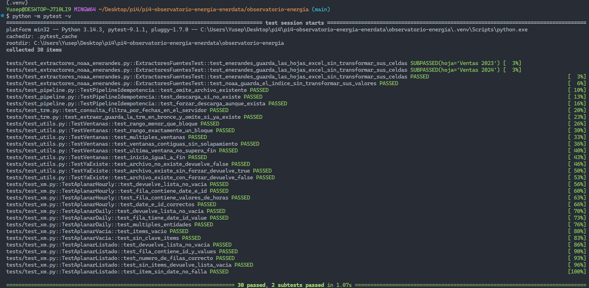
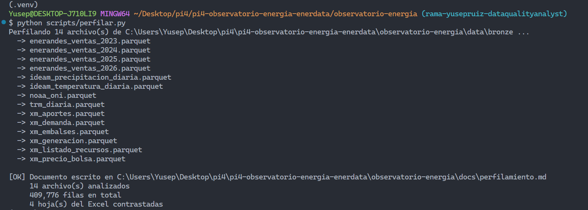

# Observatorio Energía y Clima – Equipo EnerData

> Proyecto Integrado IV – Integración de Información · IU Digital de Antioquia · 2026-2
> **EA1 – Extracción de datos de fuentes reales con Python**

## 👥 Integrantes

| Nombre | Usuario GitHub | Rol |
|---|---|---|
| Jorge Rodriguez | @jorgerodriguezdev | Líder técnico / Data Engineer |
| Yusep Ruiz | @yusepruiz | Data Quality Analyst |
| Lina Johana Seguro | @LinaSeguro | Analytics Engineer |
| Raúl Niño | @Buclex | BI Analyst / Storyteller |

## 🎯 Objetivo

Integrar datos del mercado eléctrico (XM), del clima (IDEAM y NOAA) y de ventas internas (EnerAndes) para analizar el riesgo energético de Colombia ante El Niño 2026.

En esta evidencia (EA1) se construye la **capa bronce**: un programa en Python que extrae cinco fuentes reales y las guarda **tal como llegan**, sin limpiarlas, en formato Parquet y con el registro de su origen (linaje).

## 📦 Fuentes de datos (capa bronce)

| Fuente | Tipo | Archivo en `data/bronze/` |
|---|---|---|
| XM – API Sinergox | API REST (POST, JSON) | `xm_precio_bolsa`, `xm_demanda`, `xm_embalses`, `xm_generacion`, `xm_aportes`, `xm_listado_recursos` |
| IDEAM – datos.gov.co | API Socrata (SoQL) | `ideam_precipitacion_diaria`, `ideam_temperatura_diaria` |
| NOAA – índice ONI | Archivo de texto | `noaa_oni` |
| EnerAndes | Excel interno | `enerandes_ventas_2023` … `enerandes_ventas_2026` |
| **TRM – Banco de la República (fuente propia)** | API Socrata (SoQL) | `trm_diaria` |

### Fuente propia: TRM (Tasa de Cambio Representativa del Mercado)

- **Qué es:** el valor oficial diario del dólar en pesos colombianos (USD/COP).
- **De dónde viene:** portal de datos abiertos datos.gov.co, dataset "TRM – Banco de la República, tasa de cambio diaria" (`32sa-8pi3`), consultado con SoQL y filtrado por fechas en el servidor.
- **Para qué la usamos:** en un año de El Niño baja la generación hidráulica y el sistema recurre más a plantas térmicas, cuyos combustibles se cotizan en dólares. Cruzaremos la TRM con el precio de bolsa de XM para analizar cuánto del costo de la energía se explica por el tipo de cambio.

### Rangos de fechas

| Fuente | Rango |
|---|---|
| XM | 2024-01-01 a 2026-09-30 |
| IDEAM (lluvia y temperatura) | 2025-01-01 a 2026-09-30 (el IDEAM publica con retraso: el último dato es del 2026-07-24) |
| TRM | 2024-01-01 a 2026-09-30 |

## ⚙️ Cómo ejecutar

Requisitos: Python 3.11 o superior, Git y VS Code.

```powershell
git clone https://github.com/jorearmando15/pi4-observatorio-energia-enerdata.git
cd pi4-observatorio-energia-enerdata
python -m venv .venv
.\.venv\Scripts\Activate.ps1
python -m pip install -r requirements.txt
# copiar ventas_enerandes_2023_2026.xlsx en data/insumos/
python -m src.pipeline          # descarga las 5 fuentes a data/bronze/ (unos 40 minutos, casi todo es el IDEAM)
python -m src.transformar       # limpia y valida plata, luego construye y prueba oro con dbt
python -m src.consultar         # consultas SQL de BI con DuckDB
```

> Si el repositorio tiene el proyecto dentro de la carpeta `observatorio-energia`, entra a ella con `cd observatorio-energia` antes de crear el entorno virtual.

`python -m src.transformar` requiere los datos de bronce existentes y `dbt-duckdb`
instalado en el entorno virtual. No descarga datos: primero ejecuta todas las
limpiezas y validaciones de plata y genera el reporte de calidad; solo si esa
etapa termina correctamente ejecuta `dbt build` para crear y probar oro. Para
ejecutar únicamente la limpieza de plata, usa `python -m src.silver.pipeline`.

Para volver a descargar todo: `python -m src.pipeline --forzar`. El rango de fechas se cambia en `src/config.py`.

### XM (API REST del mercado eléctrico)

El pipeline consulta la API de XM con peticiones `POST` y cuerpo JSON, en **ventanas de 30 días** (el máximo que acepta la API), del 2024-01-01 al 2026-09-30. Extrae seis archivos:

- **Por hora:** precio de bolsa (`PrecBolsNaci`), demanda real (`DemaReal`) y generación por planta (`Gene`, entidad `Recurso`).
- **Por día:** porcentaje útil de embalses (`PorcVoluUtilDiar`) y aportes hídricos (`AporEner`).
- **Catálogo de plantas** (`ListadoRecursos`): se consulta en el endpoint `lists`, no por ventanas de fechas, y responde con una estructura distinta (`Items > ListEntities > Values`), que se aplana con `aplanar_listado()`.

Cada métrica nueva se agrega como una línea en `XM_METRICAS` de `src/config.py`, y los catálogos en `XM_LISTADOS`. Para ejecutar solo XM (unos 10 minutos):

```powershell
python -m src.extract.xm
```

### IDEAM (datos abiertos con SoQL)

Extrae, para el departamento de Antioquia, la **precipitación** y la **temperatura del aire** (datasets `s54a-sgyg` y `sbwg-7ju4` de datos.gov.co) desde el 2025-01-01, semana por semana. Estos datasets tienen millones de observaciones, así que el **filtrado y la agregación se hacen en el servidor** con SoQL y no en Python:

- `$where` filtra el departamento y las fechas de cada semana.
- `$select` calcula una fila por estación y día: la suma de lluvia (`sum`) o la temperatura media, mínima y máxima (`avg`, `min`, `max`).
- `$group`, `$limit` y `$offset` agrupan por estación y día y paginan la respuesta.

El IDEAM publica con retraso: el último dato disponible es del **2026-07-24**, y las semanas posteriores devuelven 0 filas. No es un error del pipeline. Para ejecutar solo el IDEAM (unos 17 minutos):

```powershell
python -m src.extract.ideam
```

### NOAA y ventas de EnerAndes

El pipeline extrae el índice ONI de NOAA desde su archivo de texto y las hojas del Excel `data/insumos/ventas_enerandes_2023_2026.xlsx`. Cada hoja de ventas se guarda por separado. En la capa bronce se conservan sus filas y valores de origen; solo se asignan nombres de columna para las hojas de Excel y se agregan los campos de linaje `_fuente`, `_origen` y `_extraido_en`. La limpieza y normalización corresponde a capas posteriores.

El Excel de EnerAndes es un insumo local y no se descarga automáticamente. Debe obtenerse por un canal autorizado. Para ejecutar solo las extracciones de estas dos fuentes:

```powershell
python -m src.extract.noaa
python -m src.extract.enerandes
```

### TRM (fuente propia)

Descarga la tasa de cambio USD/COP del dataset `32sa-8pi3` de datos.gov.co, filtrada por fechas en el servidor, y la guarda como `trm_diaria`. Para ejecutar solo esta fuente:

```powershell
python -m src.extract.trm
```

## 🥇 Capa oro: modelo estrella y consultas de negocio

La capa oro se construye con dbt en `data/observatorio.duckdb` y contiene
**3 tablas de hechos y 5 dimensiones**. La documentación completa está en:

- [`docs/modelo_dimensional.md`](docs/modelo_dimensional.md): diagrama Mermaid
  del esquema estrella y explicación del grano de cada hecho.
- [`docs/diccionario_datos.md`](docs/diccionario_datos.md): diccionario con
  columna, tipo de dato, descripción y origen de las 8 tablas de oro.

Para reconstruir solo la capa oro, con plata ya procesada y las fuentes de
bronce requeridas disponibles:

```powershell
.\.venv\Scripts\dbt.exe build --project-dir dbt --profiles-dir dbt
```

Para construir primero plata y después oro con un solo comando, usa
`python -m src.transformar` desde la raíz de `observatorio-energia`.

### Consultas de negocio

Las consultas SQL están en `consultas/oro/` y se ejecutan contra la base oro en
modo solo lectura:

```powershell
.\.venv\Scripts\python.exe -c "import duckdb, pathlib; con=duckdb.connect('data/observatorio.duckdb', read_only=True); [print('==', p.name, '==\n', con.sql(p.read_text(encoding='utf-8')).df().to_string(index=False)) for p in sorted(pathlib.Path('consultas/oro').glob('*.sql'))]"
```

#### 1. ¿Cómo cambian el precio y la demanda según la fase ENSO?

Consulta: `consultas/oro/01_impacto_enso_precio_demanda.sql`

| fase_enso | horas | precio_promedio_cop_kwh | demanda_promedio_kwh | precio_maximo_cop_kwh |
|:---|---:|---:|---:|---:|
| El Niño | 5,856 | 661 | 9,753,759 | 1,279 |
| Neutral | 15,312 | 414 | 9,475,758 | 2,676 |
| La Niña | 2,208 | 223 | 9,650,512 | 1,079 |

**Lectura:** en promedio, la energía es más cara en El Niño (661 COP/kWh) que
en Neutral (414) y que en La Niña (223). La demanda promedio es similar en las
tres fases, así que la diferencia de precio no se explica solo por demanda: es
consistente con una menor oferta hidráulica en la fase cálida. La consulta
excluye las 720 horas de septiembre de 2026 que aún no tienen ONI.

#### 2. ¿Cómo evolucionó la matriz de generación por tipo de planta?

Consulta: `consultas/oro/02_matriz_generacion_por_tipo.sql`

| anio | tipo | generacion_gwh | participacion_pct |
|---:|:---|---:|---:|
| 2024 | Hidráulica | 54,494.3 | 66.1 |
| 2024 | Térmica | 24,441.8 | 29.7 |
| 2024 | Solar | 3,297.2 | 4.0 |
| 2024 | Eólica | 148.8 | 0.2 |
| 2025 | Hidráulica | 68,099.4 | 81.5 |
| 2025 | Térmica | 10,813.8 | 12.9 |
| 2025 | Solar | 4,473.8 | 5.4 |
| 2025 | Eólica | 154.9 | 0.2 |
| 2026 | Hidráulica | 47,528.3 | 72.2 |
| 2026 | Térmica | 12,935.5 | 19.6 |
| 2026 | Solar | 5,229.4 | 7.9 |
| 2026 | Eólica | 155.2 | 0.2 |

**Lectura:** 2025 fue el año más húmedo de la muestra (81,5% hidráulica y
12,9% térmica). En 2026 (enero a septiembre) la hidráulica baja a 72,2% y la
térmica sube a 19,6%, señal de mayor dependencia de plantas térmicas. 2024 ya
había sido un año seco (66,1% hidráulica y 29,7% térmica). La comparación de
2026 es indicativa porque el año está incompleto. La tabla incluye las cuatro
tecnologías principales; Cogenerador y No informado quedan fuera.

#### 3. ¿En qué horas se concentra la demanda y cuándo es más cara la energía?

Consulta: `consultas/oro/03_perfil_horario_demanda_precio.sql`

| hora | precio_promedio_cop_kwh | demanda_promedio_kwh |
|---:|---:|---:|
| 1 | 420 | 8,712,276 |
| 2 | 410 | 8,416,696 |
| 3 | 398 | 8,200,509 |
| 4 | 392 | 8,082,390 |
| 5 | 399 | 8,169,164 |
| 6 | 418 | 8,396,449 |
| 7 | 415 | 8,495,009 |
| 8 | 407 | 8,905,922 |
| 9 | 404 | 9,341,291 |
| 10 | 405 | 9,634,153 |
| 11 | 420 | 9,965,998 |
| 12 | 438 | 10,239,409 |
| 13 | 438 | 10,236,644 |
| 14 | 450 | 10,313,571 |
| 15 | 471 | 10,439,279 |
| 16 | 490 | 10,446,260 |
| 17 | 508 | 10,343,585 |
| 18 | 522 | 10,229,709 |
| 19 | 611 | 10,752,275 |
| 20 | 659 | 10,909,207 |
| 21 | 585 | 10,690,808 |
| 22 | 533 | 10,271,439 |
| 23 | 492 | 9,713,525 |
| 24 | 458 | 9,162,098 |

**Lectura:** la demanda máxima se concentra entre las horas 19 y 21 (10,75 a
10,91 GWh/h) y el precio promedio máximo ocurre en la hora 20 (659 COP/kWh).
Las horas 3 a 5 son el valle, con precios de 392 a 399 COP/kWh y demanda de
8,08 a 8,20 GWh/h. La hora 1 equivale a 00:00-01:00 y la 24 a 23:00-24:00.

#### 4. ¿Qué municipios concentran las ventas de energía de EnerAndes?

Consulta: `consultas/oro/04_ventas_por_municipio.sql`

| municipio | energia_gwh | valor_millones_cop | clientes_promedio_mes |
|:---|---:|---:|---:|
| Medellín | 1,246.7 | 1,250,093 | 79,774 |
| Bello | 318.4 | 319,371 | 20,116 |
| Itagüí | 239.9 | 240,529 | 15,524 |
| Envigado | 211.1 | 209,413 | 13,697 |
| Rionegro | 150.1 | 150,527 | 9,752 |
| Sabaneta | 111.5 | 111,511 | 7,106 |
| Apartadó | 100.1 | 98,993 | 6,422 |
| Turbo | 73.8 | 73,772 | 4,779 |
| La Estrella | 62.2 | 61,756 | 3,984 |
| Caldas | 62.1 | 61,707 | 4,009 |

**Lectura:** Medellín concentra 1.246,7 GWh, cerca del 44% de la energía
vendida por EnerAndes, y un promedio de 79.774 clientes por mes. Los 10
municipios de la tabla reúnen alrededor del 91% del total vendido, así que el
mercado está altamente concentrado en el Valle de Aburrá y el Oriente
antioqueño.

## 🧪 Pruebas automáticas

```powershell
python -m pytest
```

Verifican, entre otras cosas, que `ventanas()` parta bien un rango de fechas, que `aplanar()` y `aplanar_listado()` conviertan bien un JSON de ejemplo, que la consulta SoQL del IDEAM agregue en el servidor y que el pipeline omita los archivos que ya existen. Usan una red simulada, así que no dependen de internet.

## 🗂️ Muestras de los datos

Después de ejecutar el pipeline, genera un CSV con hasta 200 filas por cada Parquet de bronce:

```powershell
python -m src.muestras
```

Los archivos se guardan en `data/sample/`, conservan los encabezados y las columnas de linaje y no reemplazan los Parquet originales. Los datos completos de `data/bronze/` **no** se suben a GitHub.

## 🔎 Perfilamiento de los datos

```powershell
python -m src.perfilamiento
```

Genera `docs/perfilamiento.md` con una tabla por cada archivo de bronce (filas, columnas, tipos de dato, % de nulos, filas duplicadas y rango de fechas) y los hallazgos de calidad con su evidencia numérica.

## 📸 Capturas de la consola

**Pipeline completo** (`python -m src.pipeline`):


**Pruebas** (`python -m pytest`):



**Perfilamiento** (`python src/perfilar.py`):



## 🎥 Videos de sustentación

| Integrante | Rol | Video |
|---|---|---|
| Jorge Rodriguez | Líder técnico / Data Engineer | [Ver video](https://drive.google.com/file/d/1bNzNJwje_EeHqYgiBoDBWKPW9aPt2dA1/view?usp=sharing) |
| Yusep Ruiz | Data Quality Analyst | [Ver video](https://drive.google.com/file/d/1quJ8_TNNZsXduqJig9HSMViziSR730vp/view?usp=sharing) |
| Lina Johana Seguro | Analytics Engineer | [Ver video](https://drive.google.com/file/d/1zafbLwwhQ_-Nvk-pmjohu1Ui20SjReix/view?usp=sharing) |
| Raúl Niño | BI Analyst / Storyteller | [Ver video](https://drive.google.com/file/d/1NDFI49wHwS2ki0AsmxmCEgZ0HVhW3n1h/view?usp=sharing) |

## 🏗️ Arquitectura

```
Fuentes -> BRONCE (dato tal cual + linaje) -> PLATA (limpio) -> ORO (modelo estrella) -> Dashboard
```

## 🤖 Uso de IA

Se usó Claude (Anthropic) como asistente de programación para escribir y explicar parte del código de los extractores, las pruebas con pytest y los scripts de muestras y perfilamiento. El equipo ejecutó, revisó y probó el código contra las fuentes reales.
