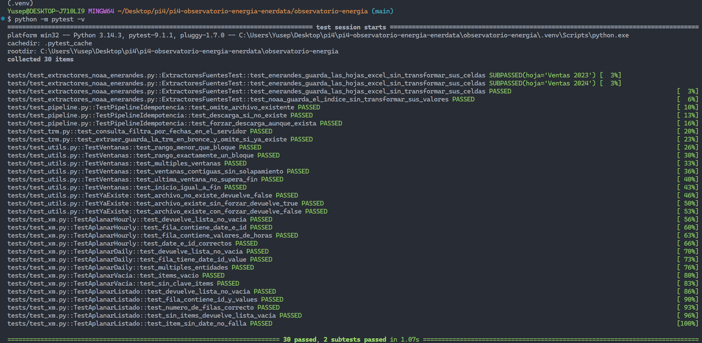
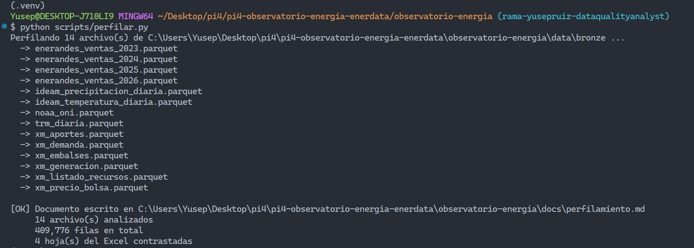

# Observatorio Energía y Clima – Equipo EnerData

> Proyecto Integrado IV – Integración de Información · IU Digital de Antioquia · 2026-2
> **EA1 – Extracción de datos de fuentes reales con Python**

## 👥 Integrantes

| Nombre | Usuario GitHub | Rol |
|---|---|---|
| Jorge Rodriguez | @jorgerodriguezdev | Líder técnico / Data Engineer |
| Yusep Ruiz | @yusepruiz | Data Quality Analyst |
| Lina Johana Seguro | @LinaSeguro | Analytics Engineer |
| Raúl Niño | @Buclex | BI Analyst / Storyteller |

## 🎯 Objetivo

Integrar datos del mercado eléctrico (XM), del clima (IDEAM y NOAA) y de ventas internas (EnerAndes) para analizar el riesgo energético de Colombia ante El Niño 2026.

En esta evidencia (EA1) se construye la **capa bronce**: un programa en Python que extrae cinco fuentes reales y las guarda **tal como llegan**, sin limpiarlas, en formato Parquet y con el registro de su origen (linaje).

## 📦 Fuentes de datos (capa bronce)

| Fuente | Tipo | Archivo en `data/bronze/` |
|---|---|---|
| XM – API Sinergox | API REST (POST, JSON) | `xm_precio_bolsa`, `xm_demanda`, `xm_embalses`, `xm_generacion`, `xm_aportes`, `xm_listado_recursos` |
| IDEAM – datos.gov.co | API Socrata (SoQL) | `ideam_precipitacion_diaria`, `ideam_temperatura_diaria` |
| NOAA – índice ONI | Archivo de texto | `noaa_oni` |
| EnerAndes | Excel interno | `enerandes_ventas_2023` … `enerandes_ventas_2026` |
| **TRM – Banco de la República (fuente propia)** | API Socrata (SoQL) | `trm_diaria` |

### Fuente propia: TRM (Tasa de Cambio Representativa del Mercado)

- **Qué es:** el valor oficial diario del dólar en pesos colombianos (USD/COP).
- **De dónde viene:** portal de datos abiertos datos.gov.co, dataset "TRM – Banco de la República, tasa de cambio diaria" (`32sa-8pi3`), consultado con SoQL y filtrado por fechas en el servidor.
- **Para qué la usamos:** en un año de El Niño baja la generación hidráulica y el sistema recurre más a plantas térmicas, cuyos combustibles se cotizan en dólares. Cruzaremos la TRM con el precio de bolsa de XM para analizar cuánto del costo de la energía se explica por el tipo de cambio.

### Rangos de fechas

| Fuente | Rango |
|---|---|
| XM | 2024-01-01 a 2026-09-30 |
| IDEAM (lluvia y temperatura) | 2025-01-01 a 2026-09-30 (el IDEAM publica con retraso: el último dato es del 2026-07-24) |
| TRM | 2024-01-01 a 2026-09-30 |

## ⚙️ Cómo ejecutar

Requisitos: Python 3.11 o superior, Git y VS Code.

```powershell
git clone https://github.com/jorearmando15/pi4-observatorio-energia-enerdata.git
cd pi4-observatorio-energia-enerdata
python -m venv .venv
.\.venv\Scripts\Activate.ps1
python -m pip install -r requirements.txt
# copiar ventas_enerandes_2023_2026.xlsx en data/insumos/
python -m src.pipeline          # descarga las 5 fuentes a data/bronze/ (unos 40 minutos, casi todo es el IDEAM)
python -m src.consultar         # consultas SQL de BI con DuckDB
```

> Si el repositorio tiene el proyecto dentro de la carpeta `observatorio-energia`, entra a ella con `cd observatorio-energia` antes de crear el entorno virtual.

Para volver a descargar todo: `python -m src.pipeline --forzar`. El rango de fechas se cambia en `src/config.py`.

### XM (API REST del mercado eléctrico)

El pipeline consulta la API de XM con peticiones `POST` y cuerpo JSON, en **ventanas de 30 días** (el máximo que acepta la API), del 2024-01-01 al 2026-09-30. Extrae seis archivos:

- **Por hora:** precio de bolsa (`PrecBolsNaci`), demanda real (`DemaReal`) y generación por planta (`Gene`, entidad `Recurso`).
- **Por día:** porcentaje útil de embalses (`PorcVoluUtilDiar`) y aportes hídricos (`AporEner`).
- **Catálogo de plantas** (`ListadoRecursos`): se consulta en el endpoint `lists`, no por ventanas de fechas, y responde con una estructura distinta (`Items > ListEntities > Values`), que se aplana con `aplanar_listado()`.

Cada métrica nueva se agrega como una línea en `XM_METRICAS` de `src/config.py`, y los catálogos en `XM_LISTADOS`. Para ejecutar solo XM (unos 10 minutos):

```powershell
python -m src.extract.xm
```

### IDEAM (datos abiertos con SoQL)

Extrae, para el departamento de Antioquia, la **precipitación** y la **temperatura del aire** (datasets `s54a-sgyg` y `sbwg-7ju4` de datos.gov.co) desde el 2025-01-01, semana por semana. Estos datasets tienen millones de observaciones, así que el **filtrado y la agregación se hacen en el servidor** con SoQL y no en Python:

- `$where` filtra el departamento y las fechas de cada semana.
- `$select` calcula una fila por estación y día: la suma de lluvia (`sum`) o la temperatura media, mínima y máxima (`avg`, `min`, `max`).
- `$group`, `$limit` y `$offset` agrupan por estación y día y paginan la respuesta.

El IDEAM publica con retraso: el último dato disponible es del **2026-07-24**, y las semanas posteriores devuelven 0 filas. No es un error del pipeline. Para ejecutar solo el IDEAM (unos 17 minutos):

```powershell
python -m src.extract.ideam
```

### NOAA y ventas de EnerAndes

El pipeline extrae el índice ONI de NOAA desde su archivo de texto y las hojas del Excel `data/insumos/ventas_enerandes_2023_2026.xlsx`. Cada hoja de ventas se guarda por separado. En la capa bronce se conservan sus filas y valores de origen; solo se asignan nombres de columna para las hojas de Excel y se agregan los campos de linaje `_fuente`, `_origen` y `_extraido_en`. La limpieza y normalización corresponde a capas posteriores.

El Excel de EnerAndes es un insumo local y no se descarga automáticamente. Debe obtenerse por un canal autorizado. Para ejecutar solo las extracciones de estas dos fuentes:

```powershell
python -m src.extract.noaa
python -m src.extract.enerandes
```

### TRM (fuente propia)

Descarga la tasa de cambio USD/COP del dataset `32sa-8pi3` de datos.gov.co, filtrada por fechas en el servidor, y la guarda como `trm_diaria`. Para ejecutar solo esta fuente:

```powershell
python -m src.extract.trm
```

## 🧪 Pruebas automáticas

```powershell
python -m pytest
```

Verifican, entre otras cosas, que `ventanas()` parta bien un rango de fechas, que `aplanar()` y `aplanar_listado()` conviertan bien un JSON de ejemplo, que la consulta SoQL del IDEAM agregue en el servidor y que el pipeline omita los archivos que ya existen. Usan una red simulada, así que no dependen de internet.

## 🗂️ Muestras de los datos

Después de ejecutar el pipeline, genera un CSV con hasta 200 filas por cada Parquet de bronce:

```powershell
python -m src.muestras
```

Los archivos se guardan en `data/sample/`, conservan los encabezados y las columnas de linaje y no reemplazan los Parquet originales. Los datos completos de `data/bronze/` **no** se suben a GitHub.

## 🔎 Perfilamiento de los datos

```powershell
python -m src.perfilamiento
```

Genera `docs/perfilamiento.md` con una tabla por cada archivo de bronce (filas, columnas, tipos de dato, % de nulos, filas duplicadas y rango de fechas) y los hallazgos de calidad con su evidencia numérica.

## 📸 Capturas de la consola

**Pipeline completo** (`python -m src.pipeline`):


**Pruebas** (`python -m pytest`):



**Perfilamiento** (`python scripts.perfilar.py`):



## 🎥 Videos de sustentación

| Integrante | Rol | Video |
|---|---|---|
| Jorge Rodriguez | Líder técnico / Data Engineer | [Ver video](https://drive.google.com/file/d/1bNzNJwje_EeHqYgiBoDBWKPW9aPt2dA1/view?usp=sharing) |
| Yusep Ruiz | Data Quality Analyst | [Ver video](https://drive.google.com/file/d/1quJ8_TNNZsXduqJig9HSMViziSR730vp/view?usp=sharing) |
| Lina Johana Seguro | Analytics Engineer | [Ver video](https://drive.google.com/file/d/1zafbLwwhQ_-Nvk-pmjohu1Ui20SjReix/view?usp=sharing) |
| Raúl Niño | BI Analyst / Storyteller | [Ver video](PEGAR_ENLACE) |

## 🏗️ Arquitectura

```
Fuentes -> BRONCE (dato tal cual + linaje) -> PLATA (limpio) -> ORO (modelo estrella) -> Dashboard
```

## 🤖 Uso de IA

Se usó Claude (Anthropic) como asistente de programación para escribir y explicar parte del código de los extractores, las pruebas con pytest y los scripts de muestras y perfilamiento. El equipo ejecutó, revisó y probó el código contra las fuentes reales.
