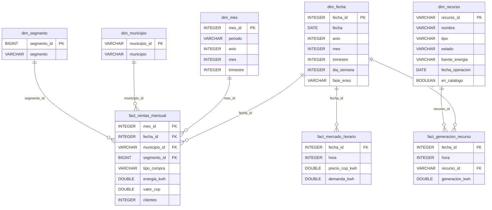

# Modelo dimensional de la capa oro

> **Proyecto:** Observatorio Energía y Clima – Equipo EnerData  
> **Capa:** Oro (modelo estrella)  
> **Base de datos:** `data/observatorio.duckdb` (esquema `main`)  
> **Construido con:** dbt sobre los Parquet de la capa bronce

Este documento describe el **esquema estrella** que alimenta el dashboard y las
consultas de negocio. El modelo tiene **3 tablas de hechos** y **5 dimensiones**.
Cada hecho está rodeado por las dimensiones que describen su contexto, y el
grano de cada hecho se indica explícitamente para evitar dobles conteos.

## Diagrama del esquema estrella



> En Mermaid, `||--o{` significa "una fila de la dimensión se relaciona con
> muchas filas del hecho". Las llaves compuestas de los hechos se explican en
> la sección **Grano de cada hecho**.

## Dimensiones

| Dimensión | Grano | Llave | Filas | Para qué sirve |
|---|---|---|---:|---|
| `dim_fecha` | Un día | `fecha_id` (AAAAMMDD) | 1.461 | Calendario diario con mes, trimestre, día de la semana y fase ENSO. |
| `dim_mes` | Un mes | `mes_id` (AAAAMM) | 45 | Mes con ventas, su año y su trimestre. |
| `dim_municipio` | Un municipio | `municipio_id` (DIVIPOLA) | 15 | Municipio de Antioquia y su código DANE. |
| `dim_segmento` | Un segmento | `segmento_id` | 4 | Segmento de cliente: Comercial, Industrial, Residencial o No informado. |
| `dim_recurso` | Un recurso (planta) | `recurso_id` | 2.501 | Planta de generación con tipo, estado y fuente de energía. |

`dim_recurso` contiene los 2.491 códigos del catálogo `ListadoRecursos` y 10
códigos adicionales que solo aparecen generando en `xm_generacion`. Estos 10
quedan con `en_catalogo = false` para que ninguna llave de
`fact_generacion_recurso` quede huérfana.

## Grano de cada hecho

| Hecho | Grano | Filas | Periodo | Medidas |
|---|---|---:|---|---|
| `fact_ventas_mensual` | Un mes, un municipio, un segmento y un tipo de compra | 4.007 | 2023-01 a 2026-09 | `energia_kwh`, `valor_cop`, `clientes` |
| `fact_mercado_horario` | Un día y una hora | 24.096 | 2024-01-01 a 2026-09-30 | `precio_cop_kwh`, `demanda_kwh` |
| `fact_generacion_recurso` | Un día, una hora y un recurso (planta) | 5.935.449 | 2024-01-01 a 2026-09-30 | `generacion_kwh` |

### `fact_ventas_mensual`

- **Una fila representa:** las ventas de un municipio, en un segmento y un tipo
  de compra, durante un mes.
- **Llaves que forman el grano:** `mes_id`, `municipio_id`, `segmento_id`,
  `tipo_compra`.
- **Llaves hacia dimensiones:** `mes_id` → `dim_mes`, `fecha_id` → `dim_fecha`
  (día 1 del mes), `municipio_id` → `dim_municipio`, `segmento_id` →
  `dim_segmento`.
- **Medidas:** `energia_kwh` y `valor_cop` son aditivas entre todos los
  municipios, segmentos y meses. `clientes` es un conteo mensual: se puede
  sumar dentro de un mes, pero no se debe sumar entre meses como si fueran
  clientes distintos.
- **Ejemplo:** una fila de Medellín, segmento Industrial, tipo Contrato, mes
  2026-09, con su energía, valor y número de clientes.

### `fact_mercado_horario`

- **Una fila representa:** el precio de bolsa y la demanda real del sistema en
  una hora concreta de un día concreto.
- **Llave que forma el grano:** `fecha_id` + `hora`. `hora` va de 1 a 24, donde
  1 = 00:00-01:00 y 24 = 23:00-24:00.
- **Llave hacia dimensión:** `fecha_id` → `dim_fecha`.
- **Medidas:** `demanda_kwh` es aditiva en el tiempo (se puede sumar por día,
  mes o año). `precio_cop_kwh` **no** es aditivo: para agregarlo hay que
  promediarlo, porque un precio promedio no se obtiene sumando precios.
- **Ejemplo:** 2026-09-30, hora 20, con su precio y su demanda.

### `fact_generacion_recurso`

- **Una fila representa:** la energía generada por una planta en una hora
  concreta de un día concreto.
- **Llave que forma el grano:** `fecha_id` + `hora` + `recurso_id`.
- **Llaves hacia dimensiones:** `fecha_id` → `dim_fecha`, `recurso_id` →
  `dim_recurso`.
- **Medida:** `generacion_kwh` es aditiva entre plantas y entre horas.
- **Nota:** XM deja celdas vacías cuando una planta no reporta generación en una
  hora; esas celdas no se convierten en filas. Por eso un recurso puede tener
  menos de 24 filas en un día.
- **Ejemplo:** planta `2QBW`, 2026-09-30, hora 20, con su generación en kWh.

## Reglas de integridad

El modelo se apoya en pruebas de dbt que se ejecutan con `dbt build`:

- `unique` y `not_null` en las llaves de las 5 dimensiones.
- `relationships` en todas las llaves de los hechos que apuntan a dimensiones.
- Pruebas singulares de unicidad del grano compuesto de los 3 hechos.
- Prueba de cobertura de los años 2023, 2024, 2025 y 2026 en ventas.

Si una fila de un hecho no encuentra su dimensión, o si el grano se repite, la
prueba falla y `dbt build` no termina correctamente.

## Linaje resumido

```text
EnerAndes 2023-2026 (Excel -> Parquet bronce)
    -> stg_ventas
        -> dim_mes
        -> dim_municipio
        -> dim_segmento
        -> fact_ventas_mensual

XM ListadoRecursos (Parquet bronce)
    -> stg_listado_recursos
        -> dim_recurso

XM Precio de bolsa (Parquet bronce)
    -> stg_xm_precio
        -> fact_mercado_horario

XM Demanda (Parquet bronce)
    -> stg_xm_demanda
        -> fact_mercado_horario

XM Generación (Parquet bronce)
    -> stg_xm_generacion
        -> dim_recurso (códigos que solo generan)
        -> fact_generacion_recurso

NOAA ONI (Parquet bronce)
    -> stg_oni_mensual
        -> dim_fecha (fase ENSO)
```

## Cómo regenerar el modelo

Desde la raíz del proyecto:

```powershell
.\.venv\Scripts\dbt.exe build --project-dir dbt --profiles-dir dbt
```

El comando crea las 8 tablas de oro en `data/observatorio.duckdb` y ejecuta
todas las pruebas. La última ejecución registrada terminó con:

```text
Done. PASS=76 WARN=0 ERROR=0 SKIP=0 NO-OP=0 REUSED=0 TOTAL=76
```
